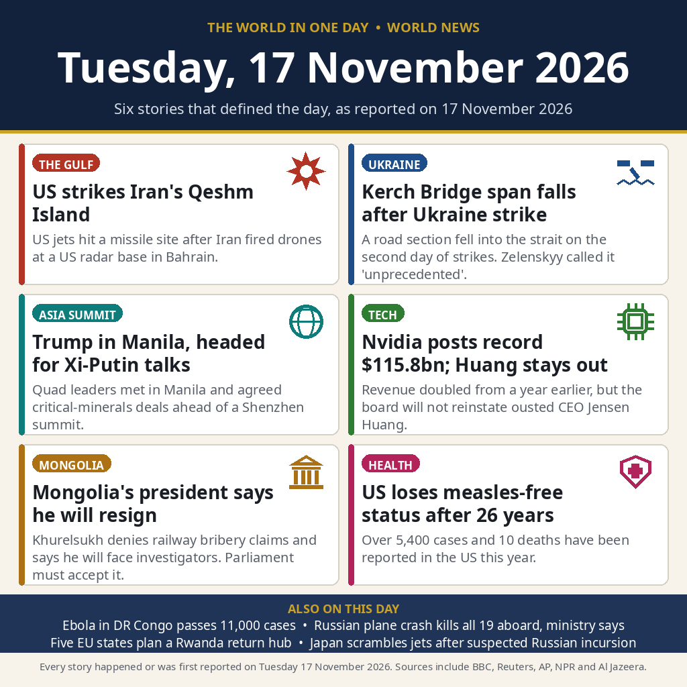

# Tuesday, 17 November 2026 — The World in One Day

[](https://make.fun/bounty/news-image-20261117?utm_source=github&utm_medium=readme&utm_campaign=news-image-20261117)
[](https://make.fun/bounty/news-image-20261117)

One image summing up the world news of **Tuesday, 17 November 2026**: a
newspaper-style poster with the day's six most consequential stories —
the US–Iran strikes in the Gulf, the Kerch Bridge attack, Trump's Asia
trip toward talks with Xi and Putin, Nvidia's record results, the
resignation announcement of Mongolia's president, and the US losing its
measles-free status — plus a ticker of further stories from the same day.



## How it works

- `render_poster.py` draws the poster programmatically with Pillow and
  real fonts (Noto Sans). Every visual cue is a simple drawn shape —
  no photographs and no AI-generated imagery of real events or people.
- `entry.png` is the finished 1024×1024 poster.
- `main.py` (Python 3.13, standard library only, no network) copies
  `entry.png` to the output directory, so repeated runs are
  byte-identical.

## Run it locally

```sh
mkdir -p out && MAKEFUN_OUTPUT_DIR=out python3 main.py
```

To rebuild the poster from scratch:

```sh
python3 render_poster.py
```

## Research

Every story on the poster happened, or was first reported, on
17 November 2026 in some time zone, and was verified against news
search results before it was drawn. Sources and per-story notes are in
[RESEARCH.md](RESEARCH.md). Nothing on the poster is invented: figures
and quotes are only those the reporting carried.

## License

MIT — see [LICENSE](LICENSE).

---

Referral code: 3a433hx8
